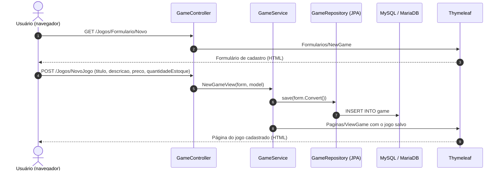
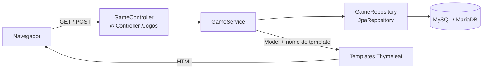
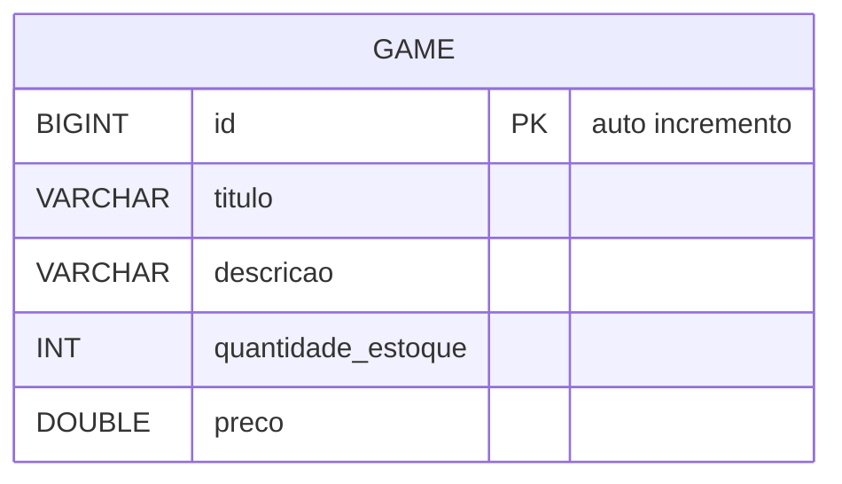

# 🎮 Game Inventory — Gestão de Estoque para Loja de Games


> Cadastro, consulta, atualização e remoção de jogos no estoque, com as páginas renderizadas pelo próprio servidor.

O **Game Inventory** é uma aplicação web **monolítica** de gerenciamento de estoque para uma loja de videogames, desenvolvida em **Java** com **Spring Boot**. Uma única aplicação Spring MVC cuida de tudo: os controllers recebem as requisições, o Spring Data JPA persiste os jogos em **MySQL/MariaDB**, e as páginas são montadas no servidor com **Thymeleaf** e estilizadas com **Bootstrap**. Não há uma API REST separada nem um front-end independente.



---

## ✨ O Problema

Lojas pequenas de videogames costumam controlar o estoque em planilhas ou anotações:

- **Sem visão rápida do que está disponível**: é difícil separar os jogos com estoque dos que estão zerados.
- **Atualizações manuais**: preço e quantidade mudam com frequência e precisam de um registro único.
- **Sem interface padronizada**: cada pessoa registra os dados de um jeito diferente.

## 🚀 A Solução

- **Catálogo completo**: tabela com todos os jogos, com título, descrição, preço e quantidade em estoque.
- **Filtro de disponíveis**: página que mostra só os jogos com estoque maior que zero.
- **Cadastro e edição**: formulário para novos jogos e edição de preço e quantidade dos existentes.
- **Exclusão** de jogos direto da tabela.

## 🎯 Diferenciais

- **Monólito simples**: um único projeto Maven entrega dados e páginas, sem configuração de CORS ou de um front-end separado.
- **Renderização no servidor**: as páginas Thymeleaf chegam prontas ao navegador, sem JavaScript.
- **Consulta derivada do Spring Data**: `findByQuantidadeEstoqueGreaterThan` gera a consulta dos jogos disponíveis a partir do nome do método.
- **Estoque nunca negativo**: na edição, uma quantidade negativa é gravada como zero.

---

## 🛠️ Stack Tecnológica

| Camada | Tecnologia |
|---|---|
| **Linguagem** | Java 8 (`java.version` 1.8) |
| **Framework** | Spring Boot 2.5.4 (Web, Data JPA, Validation, DevTools) |
| **Páginas** | Thymeleaf (renderização no servidor) |
| **Estilos** | Bootstrap 4.5.2 (via CDN) e CSS próprio nas páginas |
| **Banco de Dados** | MySQL ou MariaDB (driver `mysql-connector-java`) |
| **ORM** | Hibernate / Spring Data JPA (`ddl-auto=update`) |
| **Build** | Maven (wrapper incluso) |

---

## 🏛️ Arquitetura

A aplicação segue o padrão MVC em camadas, com o controller delegando para o serviço e o serviço escolhendo o template a renderizar:



| Camada | Classe | Responsabilidade |
| :--- | :--- | :--- |
| **Controller** | `GameController` | Mapeia as rotas em `/Jogos` e delega ao serviço |
| **Service** | `GameService` | Regras de negócio, preenche o `Model` e devolve o nome do template |
| **Repository** | `GameRepository` | `JpaRepository<Game, Long>` com a consulta de jogos disponíveis |
| **Model** | `Game` | Entidade JPA do jogo |
| **Form** | `GameForm`, `GameFormUpdate` | Dados vindos dos formulários de cadastro e de edição |

### 🗄️ Modelo de Dados



A tabela é criada e atualizada automaticamente pelo Hibernate (`spring.jpa.hibernate.ddl-auto=update`).

---

## 🗺️ Telas & Rotas

Todas as rotas ficam sob o prefixo `/Jogos` e devolvem páginas HTML.

| Método | Rota | Template | O que faz |
| :--- | :--- | :--- | :--- |
| `GET` | `/Jogos/Home` | `Paginas/Home.html` | Lista todos os jogos, com botões de editar e excluir |
| `GET` | `/Jogos/Disponiveis` | `Paginas/Disponiveis.html` | Lista só os jogos com estoque maior que zero |
| `GET` | `/Jogos/Formulario/Novo` | `Formularios/NewGame.html` | Formulário de cadastro |
| `POST` | `/Jogos/NovoJogo` | `Paginas/ViewGame.html` | Cadastra o jogo e exibe os dados salvos |
| `GET` | `/Jogos/Formulario/Editar/{id}` | `Formularios/UpdateGame.html` | Formulário de edição de preço e quantidade |
| `POST` | `/Jogos/update/{id}` | `Paginas/ViewGame.html` | Atualiza preço e quantidade e exibe o jogo |
| `GET` | `/Jogos/delete/{id}` | `Paginas/Delete.html` | Exclui o jogo e exibe a lista atualizada |

A barra de navegação das páginas tem os atalhos **Todos** (`/Jogos/Home`), **Disponiveis** (`/Jogos/Disponiveis`) e **Novo** (`/Jogos/Formulario/Novo`).

### Capturas de tela

<table>
  <tr>
    <td align="center" width="50%"><br/><sub>Todos os jogos (<code>/Jogos/Home</code>)</sub></td>
    <td align="center" width="50%"><br/><sub>Cadastro de novo jogo (<code>/Jogos/Formulario/Novo</code>)</sub></td>
  </tr>
</table>

---

## 📁 Estrutura do Projeto

```text
game-inventory-monolith/
├── ImgGit/                                   # Capturas de tela do README
├── pom.xml
├── mvnw / mvnw.cmd
└── src/
    ├── main/
    │   ├── java/br/com/GestaoDeEstoque/App/de/gerenciamento/de/estoque/
    │   │   ├── AppDeGerenciamentoDeEstoqueApplication.java
    │   │   ├── Contoller/GameController.java
    │   │   ├── Service/GameService.java
    │   │   ├── Repository/GameRepository.java
    │   │   ├── Model/Game.java
    │   │   └── Form/GameForm.java, GameFormUpdate.java
    │   └── resources/
    │       ├── application.properties
    │       └── templates/
    │           ├── Paginas/                  # Home, Disponiveis, ViewGame, Delete
    │           └── Formularios/              # NewGame, UpdateGame
    └── test/                                 # Teste de carga do contexto
```

---

## ⚡ Quick Start

### Pré-requisitos
- JDK 8 a 16 (o Spring Boot 2.5.4 não suporta versões mais novas)
- MySQL ou MariaDB em execução na porta `3306`

### 1. Clonar o repositório
```bash
git clone https://github.com/matheusnascimentods/game-inventory-monolith.git
cd game-inventory-monolith
```

### 2. Criar o banco de dados
```sql
CREATE DATABASE gestao;
```
A tabela `game` é criada automaticamente pelo Hibernate na primeira execução.

### 3. Executar a aplicação
```bash
sh mvnw spring-boot:run
```

Acesse **`http://localhost:8080/Jogos/Home`**. A raiz (`/`) não tem página.

---

## 💻 Comandos Úteis

```bash
# Compilar
sh mvnw compile

# Rodar os testes
sh mvnw test

# Empacotar o JAR e executá-lo
sh mvnw clean package
java -jar target/App-de-gerenciamento-de-estoque-0.0.1-SNAPSHOT.jar
```

O `mvnw` está versionado sem permissão de execução; por isso os comandos usam `sh mvnw`. No Windows, use `mvnw.cmd`.

---

## 🗂️ Configuração

As configurações ficam em [`application.properties`](src/main/resources/application.properties):

| Propriedade | Descrição | Valor Default (Local) |
| :--- | :--- | :--- |
| `spring.datasource.url` | URL JDBC do banco | `jdbc:mysql://localhost:3306/gestao` |
| `spring.datasource.username` | Usuário do banco | `root` |
| `spring.datasource.password` | Senha do banco | `root` |
| `spring.jpa.hibernate.ddl-auto` | Estratégia de criação do schema | `update` |

Pelo relaxed binding do Spring Boot, qualquer propriedade pode ser sobrescrita por variável de ambiente (ex.: `SPRING_DATASOURCE_PASSWORD`).

---

## 🔒 Boas Práticas & Limitações

- **Camadas separadas**: controller, serviço, repositório e formulários isolam responsabilidades mesmo num projeto pequeno.
- **Sem autenticação**: é um projeto de estudo e não deve ser exposto publicamente sem uma camada de segurança.

### Limitações conhecidas
- **Sem validação de entrada**: o `spring-boot-starter-validation` está declarado, mas os formulários não usam `@Valid`; campos vazios ou inválidos chegam ao banco ou geram erro.
- **Exclusão via `GET`**: o link de excluir remove o jogo imediatamente, sem confirmação.
- **Links absolutos**: os templates apontam para `http://localhost:8080/...`, então a aplicação só navega corretamente nessa porta e host.
- **Erros sem página própria**: um `id` inexistente gera `IllegalArgumentException` e cai na página de erro padrão do Spring.
- **Edição limitada**: só preço e quantidade podem ser alterados; título e descrição não.
- **Credenciais locais**: `root`/`root` servem apenas para desenvolvimento.
- **Testes**: só existe o teste padrão de carga do contexto, que precisa do banco disponível.
- **Nome de pacote**: o pacote do controller está grafado como `Contoller`.

---

## 🤝 Contribuindo

1. Faça um Fork do projeto
2. Crie uma branch para a sua funcionalidade (`git checkout -b feature/nome-da-feature`)
3. Faça o commit das suas alterações (`git commit -m 'feat: implementa nova funcionalidade'`)
4. Envie para o repositório remoto (`git push origin feature/nome-da-feature`)
5. Abra um **Pull Request** detalhando as alterações

---

## 📄 Licença

Distribuído sob a licença MIT. Veja [`LICENSE`](LICENSE) para mais detalhes.

---
Feito com ❤️ por [@matheusnascimentods](https://github.com/matheusnascimentods)
